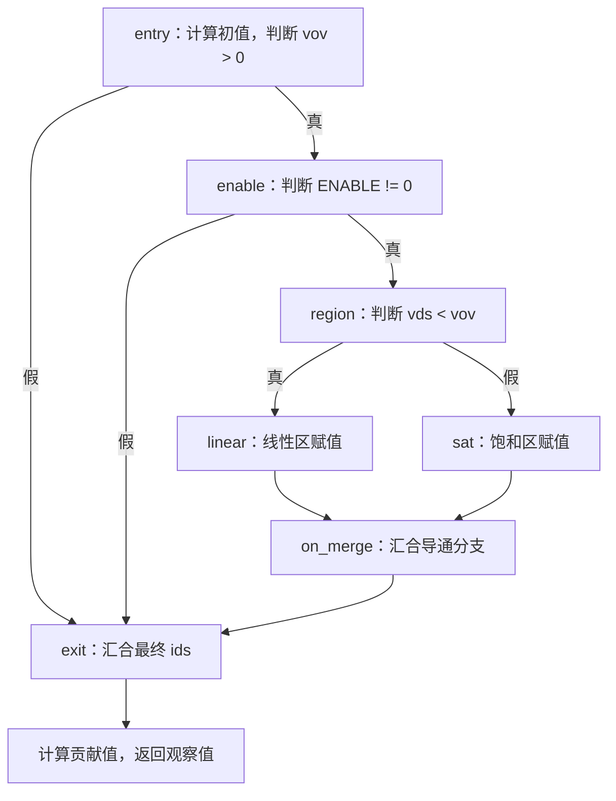

# HIR、MIR 与 CFG 后续实施方案

状态：前端、HIR/MIR/CFG/SSA、切片、AD、导数 IR、C0 和 ctypes 基线已于 2026-11-19 完成；真实模型覆盖、SIMD、NumPy 与缓存继续推进。初稿日期：2026-11-18。

当前 53 项 CTest 通过。已提供核验、导数 IR、Prepared、C0、ctypes 和 NumPy。接口见 ad.md、gradcheck.md、ad-ir.md、ad-prepared.md、c-codegen.md、numpy.md。C0 使用随产物输出的数学导数辅助函数。

## 1. 目标与顺序

现有 simple_mos 的语义与数值闭环已完成，后续按此顺序推进并逐项扩大模型覆盖：

```text
已有 AST View
    ↓
HIR：作用域、符号绑定、类型、参数、探针与贡献语义
    ↓
HIR 参考解释器：给定输入，得到 ids 与贡献值
    ↓
MIR-Local：指令 + 可变局部槽 + 基本块 + 终结指令
    ├── CFG：从跳转关系派生的图视图
    └── MIR 解释器：与 HIR 逐点对齐
    ↓
CFG 分析：可达性、支配关系、支配边界
    ↓
MIR-SSA：局部槽提升、ValueId、φ 合流
    ↓
SSA 校验与数值对齐
    ↓
目标出口值、依赖切片
    ↓
前向 AD 执行：稀疏导数存储 + 实际路径传播
    ↓
向量导数 IR：局部 DAG、数学导数内建、校验、只读执行快照
    ↓
后续 C 代码生成与绑定
```

**CFG 与 MIR 一起建立，SSA 构造依赖 CFG。** CFG 表达基本块之间的控制关系，不再独立读取源码，也不把它理解成 SSA 完成后才额外生成的另一种语法树。LLVM 的 IR 也以函数内基本块及终结指令表达控制流，可参考其 [函数与基本块说明](https://llvm.org/docs/LangRef.html#functionstructure)。

首版继续使用当前 C++20、CMake 和 MSVC 环境，逐步实现项目自己的小型 IR 与必要分析。真实模型语法覆盖与此方案并行推进，不将“先完成整个 BSIM-BULK 编译器”设为开始 HIR 的前提。

## 2. 第一个数值闭环的范围

### 2.1 固定验收对象

使用当前 testdata/simple_mos.va，默认不定义 SOFT_THRESHOLD 和 TRACE_MOS。先支持：

- 一个模块、一个普通 analog 块、实数/整数标量参数和变量。
- 参数默认值、覆盖值、参数范围、基本数值字面量。
- 算术、比较、逻辑、条件表达式、赋值和 if/else。
- max、sqrt 等已登记的纯数学函数。
- V(a,b)、已声明 branch 的电位访问、$temperature。
- 同一静态求值内可确定的 flow 贡献 I(branch) <+ expression。

SOFT_THRESHOLD 配置在纯函数 sqrt 支持后接入。TRACE_MOS 的 $strobe 需明确登记为诊断副作用，再提供诊断收集策略；在此之前给出明确的执行能力诊断，不当作纯数学函数悄悄处理。

### 2.2 定义输入和观察对象

输入分开保存：

| 输入类别 | 本模型示例 | 处理方式 |
|---|---|---|
| 模型参数 | G0、VTH0、LEAK、TNOM、ENABLE 等 | ParamEnv 按参数编号提供有效值 |
| 电路环境 | d、g、s 的节点电位 | 执行器据此计算 V(a,b)，保持方向一致 |
| 环境参数 | $temperature | 显式传入 Kelvin 温度 |
| 编译配置 | SOFT_THRESHOLD 等宏 | 属于前序编译输入，随结果记录 |

温度单位依据 [Verilog-AMS 2.4 LRM 第 9.15 节](https://www.accellera.org/images/downloads/standards/v-ams/VAMS-LRM-2-4.pdf)。参数 TNOM 在当前示例取 300，数值用例明确令 $temperature=300 K。

观察对象先提供两个：

1. **ids@exit**：当前 analog 求值到达出口时，模块变量 ids 的值。
2. **flow(ds)@exit**：该求值产生的 ds 支路 flow 贡献值。当前源码中为 ids / temperature_scale。

二者是不同的输出。更改 TNOM 或温度会影响本例贡献值，但不会改变本例 ids 的公式值。声明中的 L 当前也没有参与这两个公式。

节点电位由调用者提供，求值器负责计算模型方程。电路未知量求解、时间推进和器件连接求解仍属于仿真器工作。

### 2.3 执行能力边界

首版数值执行采用“无历史依赖的标量求值”范围。对于需要跨次 analog 执行保存变量、ddt/idt、事件调度、噪声、隐式方程求解、混合 potential/flow 源切换等情况，返回明确的能力诊断，后续再扩展 EvalContext 或方程系统。

Verilog-A 变量具有仿真生命周期语义，初始化发生在分析/仿真的相应时点；不能把所有模块变量在每次函数调用前重新清零。相关规定见 [LRM 第 3.2 与 4.6.2 节](https://www.accellera.org/images/downloads/standards/v-ams/VAMS-LRM-2-4.pdf)。

因此首版只将“本次求值内、读取前已确定赋值”的标量作为可提升局部量。无法证明时，诊断为当前执行范围需要状态支持；不将其简单判成 Verilog-A 源码非法，也不生成任意的零值或 undef 值。当前示例的 vgs、vds、vov、temperature_scale、ids 都在本次求值中先赋值。

## 3. HIR：从语法字段到明确的语义对象

### H1：声明收集、作用域与名称绑定

本批已实现。ScopeId、SymbolId、ReferenceId、Origin 与绑定结果已可查询；有类型的 ExprId/StmtId 及执行器仍属于后续批次。

按两遍完成：

1. 从 AST View 收集模块、端口、参数、变量、branch 和函数声明，建立定义与作用域。
2. 递归降低表达式和语句，将名称使用关联到对应定义。

建议的核心编号：

```cpp
struct ScopeId;
struct SymbolId;
struct ExprId;
struct StmtId;
struct ParamId;
struct ProbeId;
struct OriginId;
```

这些都是各自存储内的强类型编号，不直接复用 CST NodeId 充当 HIR ExprId。

建议结构：

| 结构 | 保存的信息 |
|---|---|
| Scope | 父作用域、当前作用域的定义、子作用域 |
| Symbol | 名字、种类、所属作用域、声明来源、类型 |
| HirExpr | 已绑定的引用、字面量、运算、转换或调用 |
| HirStmt | Assign、Block、If、Contribution 等结构化语句 |
| ParamInfo | 对应 SymbolId、默认表达式、范围、属性与覆盖策略 |
| ProbeInfo | 访问种类、正负端点、branch 别名和方向 |
| Origin | CST 节点/展开范围/必要的 token 索引，关联既有来源图 |

一个重要的合并规则：

```verilog
module simple_mos(d, g, s);
inout d, g, s;
electrical d, g, s;
```

同一个 d 的端口头、方向声明和 discipline 声明应完善同一 NetSymbol，分别保留声明位置；不能机械地报为重复定义。类型/方向冲突及真正的同作用域重复定义仍应报错。

对函数也要区分形参、局部变量及函数返回变量；内层作用域优先，模块参数可以被合法的内层声明遮蔽。声明命名空间和冲突规则按 LRM 核对后固化为测试。

现有样例没有显式 include disciplines.vams。首版提供清单化的 SemanticPrelude，登记 electrical、V、I 和已支持内建函数，并在 HIR 中记录其来源为内建环境。用户自定义 nature/discipline 通过显式定义登记；与内建项目的冲突要检查，未知类型名不兜底为 electrical。

H1 验收：

- d/g/s 三处相关声明能正确合并。
- 每个 NameExpr 的使用都绑定到一个明确 SymbolId，或给出定位诊断。
- 嵌套遮蔽、重复参数、未定义名称、函数局部参数均有测试。
- 宏复制的两个引用可以绑定同一符号，同时保留不同的来源出现位置。
- 这一交付先输出绑定结果，不依赖 MIR。

### H2：类型、有效参数与特殊访问（静态标量基线已完成）

实际实现为 typed.hpp / typed.cpp / lower.cpp / eval.cpp。完整位宽、用户模拟函数、状态运算等仍在能力边界之外，遇到会诊断；当前内建函数签名、参数、探针与贡献按下述目标验收。

首版类型至少区分 Real、Integer、String、Net、Branch、Void、Error；Bool 可作为内部条件类型，保留与 Verilog-A 数值条件之间的转换规则。整数宽度、符号和转换按所支持字面量登记，超出首版范围应诊断。

处理顺序：

1. 解码数字：例如 1m→0.001、1u→0.000001、3.0e2→300、8'h0F→15；验证整个字面量都被消费。
2. 检查运算类型、隐式数值转换、赋值目标与函数签名，必要时在 HIR 插入 Convert。
3. 建立参数依赖及 ParamEnv：先应用允许的覆盖，再计算仍需使用的默认表达式，检测循环、缺失和越界。
4. 将 inf 区间端点保存为边界信息，不误当作普通待求值变量。
5. 将 probe 和 contribution 从一般函数调用中区分出来。

| AST 形态 | HIR 含义 |
|---|---|
| 名称 G0 | Ref(SymbolId(G0)) |
| V(g,s) | ReadPotential(positive=g, negative=s) |
| V(ds) | 解析 branch 别名后读取对应电位差 |
| $temperature | EnvironmentRead(Temperature) |
| max(a,b) | 已登记签名的 PureMathCall |
| ids = expr | Assign(SymbolId(ids), ExprId(expr)) |
| I(ds) <+ expr | Contribute(Flow, BranchId(ds), ExprId(expr)) |

**参数默认值与可变输入分开。** 即使默认 G0=0.001，后续 MIR 也应能保留 LoadParam(G0)。只有显式固定的参数才允许专门化为常量，避免后续求导前就丢掉参数依赖。

BuiltinRegistry 同时登记参数类型、结果类型及效果类别：纯数学、环境读取、诊断、需状态的模拟运算。未知函数和未支持类别给出明确诊断。

H2 验收：

- 7 个模型参数的默认值、类型、属性和范围可查询。
- G0、VTH0、TNOM 覆盖能正确影响相关默认依赖和结果。
- Net 不能被当作普通实数运算，参数不能作为普通可写变量。
- V(g,s)、V(s,g)、V(d,d)、V(ds) 的端点及方向解析有测试。
- Contributions 与普通变量赋值是不同语义节点。

### H3：结构化 HIR 参考解释器（静态标量基线已完成）

直接解释 HirStmt 的 Block/If/Assign，不经过 MIR 降低，作为独立数值参考。可共享数字解析和内建数学函数实现，但不要共享 MIR 的控制流降低算法。

输入：HirModule + ParamEnv + EvalInputs。
输出：观察值、flow 贡献、诊断和必要的执行记录。

对尚不支持的状态读取、非有限值策略和数学域问题，采用显式结果状态及来源定位；不静默继续返回一个看似有效的数值。

H3 验收采用第 8 节的数值表。后续每次新增 MIR 转换，必须能与这个参考结果对照。

## 4. MIR：指令化，同时建立 CFG

### M1：先实现带局部槽的 MIR（静态标量基线已完成）

已实现当前 HIR 的指令化、if、短路和条件表达式降低。下面的循环、break/continue 与用户函数规则仍是后续扩展目标，本次没有增加这些 HIR 执行能力。实际接口为 mir.hpp、lower.cpp、eval.cpp。

先把源码变量保留为可变 LocalId 槽：

```text
v0 = read_voltage(g, s)
store local_vgs, v0
v1 = load local_vgs
v2 = load_param VTH0
v3 = fsub v1, v2
...
store local_ids, v_result
```

每个指令结果已经有唯一 ValueId，但源码可变变量仍通过 Load/Store 表达；这里称为 MIR-Local。后续再把符合条件的槽提升成 SSA，避免把“有 v 编号”与“源码变量已经全部 SSA 化”混为一谈。

最小结构示意：

```cpp
struct MirFunction {
    std::vector<LocalInfo> locals;
    std::vector<BasicBlock> blocks;
    std::vector<ValueInfo> values;
    BlockId entry;
};

struct BasicBlock {
    std::vector<Instruction> instructions;
    Terminator terminator;
};

// Terminator 为 Jump / Branch / Return / Unreachable 中的一种。
// 指令与终结指令都携带 OriginId。
```

首批指令：常量、LoadParam、ReadPotential、ReadEnvironment、LoadLocal、StoreLocal、数值转换、整数/实数运算、比较、受支持的纯函数调用、贡献与输出。

降低规则：

- 顺序语句按原顺序发出指令。
- if/else 建立条件块、分支块和汇合块。
- 在当前纯静态表达式范围内，为 &&、||、?: 保留相应的条件求值路径，不提前执行本来不该执行的数学运算。
- for/while/repeat 以循环头、循环体、回边和出口实现，先在小型语义用例中接入。
- break/continue 在所属循环上下文中解析目标，错误上下文应诊断。
- 用户函数先从纯标量、非递归、无可写实参子集接入，再扩大范围。

逻辑求值需遵守 [LRM 第 4.2.3 节](https://www.accellera.org/images/downloads/standards/v-ams/VAMS-LRM-2-4.pdf) 对模拟运算与短路的规定；当前拒绝有状态模拟运算的首版范围不能自动外推到所有未来节点。

### C1：CFG 作为 MIR 的派生图（基线已完成）

verify.cpp 已包含结构/类型/定义支配使用校验，支配分析已抽到 analysis/dominance.cpp。MIR-Local 与 SSA 基本块执行器均已和 H3、手算参考对齐。

CFG 的唯一权威来源是 BasicBlock.terminator：

```text
Jump(B)       → 一条后继边
Branch(c,T,F) → 条件后继边
Return        → 没有后继
```

CfgInfo 保存 predecessors、successors、可达性和遍历顺序，引用同一 MirFunction。修改跳转后重新构建分析结果，避免另一套手写边表与 MIR 不一致。

首版将真假目标相同的分支规范化为 Jump，保持 phi 的前驱约定清楚。以后扩展 switch/多重边时，先明确边身份及 phi 对应规则。

结构校验器至少检查：

- 一个块有且仅有一个终结指令，终结后不能追加普通指令。
- 目标 BlockId 合法，入口明确，前驱/后继互相一致。
- Operand 类型、ValueId 和 LocalId 合法。
- 不可达块有明确处理方式；提前拒绝的错误不能靠优化器掩盖。

先完成 MIR-Local 解释器，与 HIR 逐点比较，再进入 SSA。循环执行设置步数上限，超限报错，不能截断后伪装为正常结果。

## 5. SSA 构造与 CFG 分析

### C2：支配关系与数据流（基线已完成）

实际接口为 dominance.hpp；已实现支配集合、直接支配者、支配树、支配边界及活跃变量分析。未赋值状态通过 Undef/require_defined 保留逐路径检查，不把缺少赋值的路径补为零，也不宣称所有变量已经静态证明赋值。

先实现并单独测试可达块、逆后序、支配关系、支配树和支配边界。再分析 LocalId 的定义块与使用，并检查当前求值内的确定赋值。

若局部量需要历史状态、取地址或数组内存，首版不把它当作可安全提升的普通标量；保留明确的存储分类或报告尚不支持。

### S1：局部槽提升（基线已完成）

ssa.cpp 已实现活跃性裁剪的 phi 插入、重命名、冗余 phi 简化和 Value 编号压缩。全部 Local Load/Store 移除，Return 显式记录出口值；phi 按前驱并行求值。详见 SSA 实现说明。

采用“局部槽 → 支配边界插入 phi → 支配树重命名”的渐进路线：

1. 确定可以提升的 LocalId。
2. 收集它的定义块，在迭代支配边界插入所需 phi。
3. 沿支配树维护每个 LocalId 的当前定义栈。
4. Store 更新当前定义；Load 替换为当前 ValueId。
5. 按实际前驱填充 phi 输入，删除已提升的 Load/Store。
6. 删除确实冗余的 phi，再运行 SSA 校验器。

这一方法可参考 [LLVM 可变变量与 mem2reg 教程](https://llvm.org/docs/tutorial/MyFirstLanguageFrontend/LangImpl07.html)。它为分阶段实现提供参考，不要求本工程此时依赖 LLVM。

SSA 校验应检查：

- ValueId 只有一个静态定义。
- 普通操作数定义支配其使用；同块内定义先于使用。
- phi 的输入与前驱一致，类型一致，定义在对应前驱边上可用。
- phi 位于块头，非法或缺失输入不能用任意值补齐。
- 参数加载和环境读取仍保留必要依赖。

phi 的输入是在前驱边上使用的，运行时依据实际到达的前驱选择；相关规则可参考 [LLVM phi 说明](https://llvm.org/docs/LangRef.html#phi-instruction)。

MIR 解释器执行循环时，ValueId 对应的是静态指令定义，指令可以在不同迭代中重复执行。不能把某个 v 编号的结果全程只算一次；进入块时还应从前驱快照同时选择 phi 输入，避免顺序更新多个 phi 时互相污染。

## 6. 用当前 ids 说明 CFG 与 phi

当前模型先设置漏电值，再按条件覆盖：

```verilog
ids = LEAK * vds;
if ((vov > 0.0) && (ENABLE != 0)) begin
    if (vds < vov)
        ids = G0 * (vov * vds - .5 * (vds * vds));
    else
        ids = .5 * G0 * (vov * vov);
end
I(ds) <+ ids / temperature_scale;
```

拟定 CFG 如下：



下面是本项目拟定的 MIR-SSA 记法，省略已在入口计算的参数、vds、vov 和 temperature_scale：

```text
bb_entry:
    v_base = fmul p_LEAK, v_vds
    v_c0 = fgt v_vov, 0.0
    branch v_c0, bb_enable, bb_exit

bb_enable:
    v_c1 = ine p_ENABLE, 0
    branch v_c1, bb_region, bb_exit

bb_region:
    v_c2 = flt v_vds, v_vov
    branch v_c2, bb_linear, bb_sat

bb_linear:
    v_l0 = fmul v_vov, v_vds
    v_l1 = fmul v_vds, v_vds
    v_l2 = fmul 0.5, v_l1
    v_l3 = fsub v_l0, v_l2
    v_linear = fmul p_G0, v_l3
    jump bb_on_merge

bb_sat:
    v_s0 = fmul 0.5, p_G0
    v_s1 = fmul v_vov, v_vov
    v_sat = fmul v_s0, v_s1
    jump bb_on_merge

bb_on_merge:
    v_on = phi [bb_linear: v_linear], [bb_sat: v_sat]
    jump bb_exit

bb_exit:
    v_ids = phi [bb_entry: v_base],
                [bb_enable: v_base],
                [bb_on_merge: v_on]
    v_flow = fdiv v_ids, v_temperature_scale
    return {ids_at_exit: v_ids, flow_ds: v_flow}
```

源码里 ids 仍是同一个 SymbolId。MIR 中三个赋值路径产生不同值，phi 按控制流合并成出口值；ENABLE=0 或 vov≤0 时保留 v_base。

注意普通赋值是覆盖，不能把三个 ids 分支的值相加。贡献语句也要保留它自身的模型语义：同种类支路贡献可以累加，但 potential/flow 切换另有规则。首版仅在已限定的静态 flow 范围内建立贡献累加器，不能把所有 <+ 当作普通变量赋值。参见 [LRM 第 5.6.1.3 节](https://www.accellera.org/images/downloads/standards/v-ams/VAMS-LRM-2-4.pdf)。

## 7. 观察点与目标切片（Q1 基线已完成）

实际接口为 slice.hpp / slice.cpp，支持变量和命名支路 flow 出口。保留 CFG，区分默认 preserve 与显式 target-only，并分别报告目标输入和执行输入。当前不做最小 CFG 重构或全局直线化；实现范围见 docs/slice.md。

先在出口显式读取目标变量或贡献累加器，再把对应 ValueId 放入 OutputMap。不能用“文本中最后看到的一次 ids 赋值”代替出口值。

在 SSA 和数值校验通过后，再实现反向依赖切片：

- 从 OutputMap 的目标值追踪定义和使用。
- 保留 phi 的值依赖，以及决定前驱选择的控制依赖。
- 输出必要的参数、节点电位、环境输入和原始来源。
- 对副作用采用明确策略；不能因为没有返回值就删除贡献或诊断语句。
- 仍保留 CFG。循环中的 phi 和回边不能直接整理成全局无环拓扑序。

只有确认提取出的表达式子图无环时，才输出单一拓扑序。保留分支/循环的切片使用块内指令顺序加 CFG，或显式处理强连通分量。

本模型的预期依赖验收：

| 观察对象 | 必须保留的主要依赖 |
|---|---|
| ids@exit | G0、VTH0、LEAK、ENABLE，以及 g/s、d/s 电位差 |
| flow(ds)@exit | 上述依赖，再加 TNOM 与 $temperature |

L 不应出现在上述数值切片的必要参数中，但仍保留在完整 ParamTable。ENABLE 是控制依赖，后续连续参数 AD 不应把它当作普通可微实数参数。

## 8. 独立数值验收

采用默认参数 G0=0.001、VTH0=0.45、LEAK=1e-12、TNOM=300；令 s=0、g=Vgs、d=Vds。下表中的温度显式传入，ENABLE 默认 1。

| 用例 | Vgs | Vds | 温度 K | ENABLE | ids@exit | flow(ds)@exit |
|---|---:|---:|---:|---:|---:|---:|
| 截止路径 | 0.3 | 0.05 | 300 | 1 | 5e-14 | 5e-14 |
| 线性区 | 1.0 | 0.05 | 300 | 1 | 2.625e-5 | 2.625e-5 |
| 饱和区 | 1.0 | 0.8 | 300 | 1 | 1.5125e-4 | 1.5125e-4 |
| 区间边界 | 1.0 | 0.55 | 300 | 1 | 1.5125e-4 | 1.5125e-4 |
| 禁用导通 | 1.0 | 0.05 | 300 | 0 | 5e-14 | 5e-14 |
| 温度变化 | 1.0 | 0.05 | 600 | 1 | 2.625e-5 | 1.3125e-5 |

这些参考值已作为独立常量接入 hir_eval_tests.cpp 和 mir_eval_tests.cpp，HIR/MIR 运行结果全部通过误差检查；还覆盖偏置网格、参数覆盖、短路和诊断效果。

验收方式：

1. 手算参考与 HIR 解释器比较。
2. HIR 与 MIR-Local 使用完全相同的输入逐点比较。
3. MIR-Local 与 MIR-SSA 再比较。
4. ids/flow 切片前后各自比较，不混淆观察目标。
5. 对默认值、参数覆盖、参数越界、短路、单边赋值和循环零/一/多次迭代增加专门用例。

有限双精度样例可先使用 abs_error ≤ 1e-18 + 1e-12 × |reference| 的判据，并记录两侧输入与执行路径；不得靠放宽误差掩盖控制流差异。避免未经证明的浮点重结合。

## 9. 分批交付与代码位置

每批保持现有回归测试通过，并新增该批的结构与数值验收。H1 时 18 项，H2/H3 后 23 项，M1/C1 后 29 项，C2/S1 后 33 项，Q1 后 37 项；独立对齐结果和 IR 不变量是验收重点。

| 批次 | 主要交付 | 验收后再进入 |
|---|---|---|
| H1（已完成） | Scope、Symbol、声明合并、名称绑定、来源 | H2 |
| H2（基线已完成） | HIR 类型、参数有效值、Builtin/Probe/Contribution | H3 |
| H3（基线已完成） | 结构化 HIR 执行器、观察点、手算参考 | M1 |
| M1/C1（基线已完成） | MIR-Local、基本块、CFG、结构校验和执行器 | C2/S1 |
| C2/S1（基线已完成） | 支配分析、phi、重命名、SSA 校验与执行 | Q1 |
| Q1（基线已完成） | 目标出口值、输入依赖、保留控制流的切片 | 真实模型扩展与 AD |
| 前向 AD（执行基线已完成） | 稀疏支持集、参数种子、phi/flow 导数、默认参数链 | 导数 IR / C / 绑定 |

推荐新增目录：

```text
include/vagrad/frontend/hir/   HIR、降低、参数和参考执行接口
src/frontend/hir/             resolve、type_check、param_eval、lower、eval
include/vagrad/ir/mir/         MIR、降低、校验、SSA 和执行接口
src/ir/mir/                   lower、verify、ssa、eval、dump、slice
include/vagrad/analysis/      CFG 和支配分析接口
src/analysis/                 cfg、dominators
tests/                       hir_tests、mir_tests、cfg_tests、ssa_tests、数值对齐
testdata/semantic/            每个语义/控制流问题的小型回归样例
```

OriginId 沿用前序快照和来源图：HIR 关联原 AST/CST，MIR 关联 HIR 来源；若以后合并多条指令，要允许关联多个来源。所有编号均由其所属存储管理，避免把不同层的整数编号直接混用。

当前已可运行：

```text
vagrad mir <file.va> --form local -o <model.mir.txt>
vagrad cfg <file.va> -o <model.cfg.txt>
vagrad eval <file.va> --ir hir|mir-local ...
```

另保留 H1 的 `hir`、H2 的 `hir --typed` 和原有 HIR 求值命令。H2/eval 接受 --param，MIR/CFG 编译不求参数有效环境。SSA 和支配分析也已可运行：

```text
vagrad mir <file.va> --form ssa -o <model.ssa.txt>
vagrad eval <file.va> --ir mir-ssa ...
vagrad cfg <file.va> --dominators -o <dominance.txt>
```

运行时仍在内存中传递 IR，输出继续作为可选的 TXT 检查报告。现有 lex/preprocess/parse/ast 的职责保持明确，增加新命令时复用同一前序调用链。

## 10. 对 AD 与完整模型的后续衔接

在上述闭环后，AD pass 才以校验通过的 MIR-SSA 为输入，对选定的实数参数建立种子和传播规则，沿实际控制路径处理 phi。max、分支边界等不可光滑位置需明确导数策略；复步验证只用于满足解析性条件的片段，不作为所有分段模型的通用校验。

完整模型则采用固定版本、宏配置、参数卡和偏置集持续回归。遇到新语法先扩展 Parser/AST View，遇到新语义再扩展 HIR 与执行能力范围，不把“能生成 AST”误作“已经正确执行模型”。

**Q1、AD、导数 IR、快照、C0 与 ctypes 基线已验收。** C++ 支持两种参数模式，C0 目前限独立有效参数。后续扩大模型覆盖、参数语义、SIMD、NumPy 与缓存。
